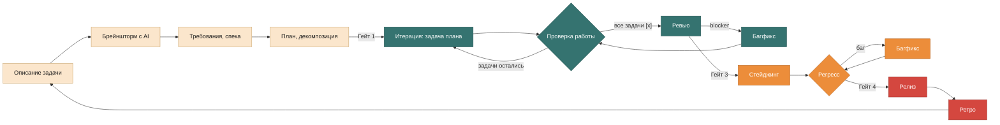

# Vadims workflow

Процесс разработки с AI-агентами: **план → разработка → ревью → стейджинг → релиз → ретро**.
Подходит для любого проекта и любой LLM: всё описано обычным Markdown.

> Пути ниже даны относительно проекта, в который workflow установлен через `scripts/init.sh`. В проекте этот файл лежит как `.workflow/WORKFLOW.md`.

## Приоритет источников

Если источники противоречат друг другу, действует порядок: человек → правила проекта (`AGENTS.md`, `docs/rules/`) → спецификация (`docs/PRD.md`, `feature-spec.md`) → `plan.md` → этот файл → промпт субагента → мнение модели. Касается всех агентов: нашёл противоречие — остановись и сообщи, не выбирай молча.

## Принципы

1. **Спецификация — единственный источник правды.** Тесты, план и код выводятся из неё. Если код расходится со спекой, сначала вместе с человеком правим спеку, потом код. Никогда наоборот.
2. **Планирование — главный этап.** Пока план не прошёл Гейт 1, к коду не приступаем.
3. **Маленькие шаги.** Большая задача режется на мелкие, каждую легко сделать и проверить. Лучше 10 мелких итераций с проверкой, чем один огромный PR, который невозможно отревьюить.
4. **Состояние живёт в файлах и Git, а не в памяти LLM.** Любую сессию можно закрыть и продолжить с того же места.
5. **Свежий контекст важнее длинной памяти.** Правила — в разделе «Контекст».
6. **Один факт — одно место.** Где что живёт — в таблице ниже. Дублировать факты между файлами нельзя.
7. **Проверка перед утверждением.** Никаких «тесты зелёные», «фикс работает», «регресс пройден» без свежего вывода команды в том же отчёте. Вывод из прошлой сессии не считается. Если проверка дорогая и уже запускалась без промежуточных изменений — так и пишем: «проверено в <место>, с тех пор код не менялся».
8. **Не угадывать и не перекладывать.** Факт, от которого зависит следующий шаг, сначала исследуем (поиск по коду, запуск, документация). Если факт не закрывается за разумное время — записываем допущение в «Решения» спеки: «считаем X, потому что Y; если неверно, сломается Z». Решение, которое агент может принять сам, человеку не выносим.
9. **План проверяется до кода.** Гейт 1 — это не только человек: сначала `plan-reviewer` проверяет `plan.md` и возвращает blocker/warning. Блокеры закрываются до начала Этапа 2.

## Где что живёт

Граница, которая убирает дубли: `AGENTS.md` **описывает, как есть**, `docs/rules/` **предписывают, как надо**, спека — **что строим**, план — **в каком порядке**, журнал — **что произошло**.

| Файл | Содержит | Пишет | Когда меняется |
|---|---|---|---|
| `AGENTS.md` (`CLAUDE.md` — симлинк на него) | WHAT: стек, карта верхнего уровня · WHY: назначение проекта и его частей · HOW: команды сборки, тестов, линтера · список файлов правил | главный агент + человек | смена стека или команд, ретро |
| `docs/rules/conventions.md` | именование, куда класть новые файлы, стиль сверх линтера | человек, ретро | ретро |
| `docs/rules/architecture.md` | архитектурные решения уровня проекта и почему они приняты | ретро, с одобрения человека | ретро |
| `docs/rules/never.md` | что нельзя никогда + повторяющиеся ошибки модели | главный агент, с одобрения человека | ошибка модели повторилась |
| `docs/rules/security.md` | правила безопасности, применимые фреймворки | человек | изменились риски |
| `docs/codemap.md` | только в больших проектах: модули, ответственность, точки входа, без кода. Шапка содержит freshness-хэш `git ls-files \| sort \| git hash-object`; при расхождении на ретро codemap считается устаревшим | главный агент | ретро |
| `.workflow/lessons/<тема>.md` | урок, повторившийся в двух фичах: правило, симптом, как распознать | главный агент, с одобрения человека | ретро |
| `docs/PRD.md` | продукт: проблема, для кого, метрики, требования, вне рамок, риски | главный агент + человек | Этап 1 |
| `docs/work/<slug>/feature-spec.md` | поведение фичи (BDD-сценарии), UI, API и данные, безопасность, решения | главный агент; разделы — субагенты | Этап 1, позже только через перепланирование |
| `docs/work/<slug>/plan.md` | чеклист задач `T1…Tn`: критерий готовности, сценарий, тип проверки, исполнитель | главный агент | Этап 1; на Этапе 2 меняются только отметки |
| `docs/work/<slug>/progress.md` | Handoff для следующей сессии + журнал: что сделано, отклонения, блокеры | главный агент | после каждой итерации |
| `docs/work/<slug>/review.md`, `security-check.md` | результаты ревью и проверки безопасности | `code-reviewer` | Этап 3 |
| описание PR | что и зачем, сценарии, как проверено (`.github/pull_request_template.md`) | главный агент | Этап 3 |

**Evidence в `progress.md`:** у каждой записи «сделано» — команда проверки и её итог одной строкой («27 тестов прошли», «линтер чист»). Запись без проверки — это не «сделано», а «написано».

**Правила для `AGENTS.md`:** держать актуальным, не больше 200 строк. Если больше — прогрессивное раскрытие: подробности выносятся в отдельный файл, а в `AGENTS.md` остаются путь простым текстом и условие («перед работой с БД прочитай docs/db.md»). `@import` не использовать: он загружает файл целиком в контекст каждой сессии. Единственное исключение: `CLAUDE.md` из одной строки `@AGENTS.md`, если симлинк невозможен (Windows).

**Решения:** решение, которое касается одной фичи, живёт в её `feature-spec.md`. В `architecture.md` оно переносится на ретро, когда становится правилом для всего проекта.

## Цикл

| Гейт | Переход | Условие |
|---|---|---|
| 1 | план → разработка | в спеке нет открытых вопросов; каждый сценарий покрыт задачами; каждая задача маленькая и проверяемая; отчёт `plan-reviewer` без blocker; человек утвердил |
| 2 | задача → следующая задача | тесты и линтер зелёные, проверка пройдена, вывод проверки записан в `progress.md`, отметка `[x]`, коммит сделан |
| 3 | ревью → стейджинг | в `review.md` и `security-check.md` нет blocker; непокрытые сценарии спеки закрыты тестами `test-writer`; PR описан и одобрен человеком |
| 4 | стейджинг → релиз | регресс зелёный, вывод регресса записан в `progress.md` |

### Лёгкий трек

Не каждая правка — фича. Опечатка, локальный багфикс без смены поведения, правка конфигурации без эффекта на контракт идут лёгким треком: без `feature-spec.md` и Гейта 1.

Лёгкий трек — это декларация в начале работы: одно предложение подхода и список затрагиваемых файлов. Дальше обычная итерация: тест → код → проверка → коммит. Журнал вести не нужно.

Любой из трипвайров переводит задачу в полный трек, без возврата назад в середине работы:

- вторая попытка фикса не удалась, или `debugger` не может назвать причину одним предложением;
- всплыл вопрос, который не закрывается одним обменом с человеком;
- правка оказалась сменой контракта: схема данных, API, формат файлов, аргументы CLI.

Полный трек начинается с того места, где застопорились: уже принятые решения записываются в спеку, и дальше — обычный Этап 1.

### Предзапусковая проверка

Перед запуском операции из списка ниже главная сессия сначала вызывает `code-reviewer` на сам запуск — команду, параметры и цель. Это проверка операции, а не кода; она дополняет Этап 3, а не заменяет его.

Триггеры:

- DDL/DML на любой БД, кроме свежесозданного локального контейнера без прод-данных;
- запросы к внешним сервисам и платным API (включая Snyk, если он ходит в сеть);
- DAST-прогон и деплой на стейджинг;
- обучение или длинный прогон: обучение модели, полный проход по данным, операция дольше ~5 минут;
- массовые запись или удаление вне дерева проекта.

Проверка одноразовая на код-путь: повторный запуск той же команды без изменений второй проверки не требует. Человек может явно снять проверку для длинных и внешних чтений («пропусти проверку, тривиально»), но не для необратимых записей и платных бюджетов.

## Этап 1. Планирование

Модель — сильная (см. «Модели»). Инструмент — встроенный режим планирования (в Claude Code — plan mode, `Shift+Tab`) или промпт `.workflow/prompts/plan.md`.

1. **Описание задачи** (человек): что нужно, для кого, какие ограничения.
2. **Брейншторм с AI:** 2–3 варианта (технологии, способы, сторонние API) с ценой каждого. Агент задаёт вопросы, а не угадывает. Выбор и причину записываем в «Решения» в `feature-spec.md`, решения уровня продукта — в `PRD.md`.
3. **Требования и спецификация.** `.workflow/feature.sh <slug>` создаёт ветку и файлы из шаблонов.
   - `PRD.md` — для нового продукта или крупного изменения.
   - `feature-spec.md` — поведение в стиле BDD: сценарии «Дано / Когда / Тогда» глазами пользователя, включая ошибки и граничные случаи. Сценарии одновременно служат требованиями и будущими тестами.
   - Раздел «UI» пишет `ui-designer`, разделы «Архитектура, API и данные» и «Безопасность» — `backend-architect`.
4. **План и декомпозиция** → `plan.md`. Каждая задача: не больше одного коммита, ссылка на сценарий, проверяемый критерий «Готово, когда», тип проверки `auto` (хватает тестов) или `manual` (нужно посмотреть глазами) и исполнитель.
5. **Гейт 1.** Если он не пройден, возвращаемся к шагу 2 или 3.

**GitHub Spec Kit и OpenSpec** — готовые инструменты spec-driven development. На проект выбирается **один** формат: шаблоны этого workflow, Spec Kit или OpenSpec. Смешивать нельзя. Файлы выбранного инструмента заменяют наши, а остальной процесс (гейты, итерации, ревью, Git, безопасность) остаётся прежним. `.workflow/ralph.sh` работает только с нашим `plan.md`; у внешних инструментов своя команда реализации.

| Наш файл | GitHub Spec Kit | OpenSpec |
|---|---|---|
| `docs/rules/` | `.specify/memory/constitution.md` — перенеси правила туда или оставь в нём ссылку, но не держи их в двух местах | остаётся `docs/rules/` |
| `PRD.md`, `feature-spec.md` | `specs/<NNN-фича>/spec.md` + технический `plan.md` | `openspec/changes/<id>/proposal.md`, `specs/`, `design.md` |
| `plan.md` | `specs/<NNN-фича>/tasks.md` | `openspec/changes/<id>/tasks.md` |

## Этап 2. Разработка

Модель — подешевле (см. «Модели»). Ветка — `feature/<slug>`.

**Итерация = одна задача из `plan.md`:**

1. Рабочее дерево чистое: это точка отката (см. «Git»).
2. TDD: пишем тест по сценарию спеки, убеждаемся, что он красный, пишем минимальный код до зелёного, затем рефакторим.
3. Запускаем тесты и линтер (команды — в `AGENTS.md`, раздел HOW).
4. Проверка работы: для `auto` хватает тестов; для `manual` человек смотрит результат или агент запускает приложение и показывает его.
5. Ставим отметку `[x]` в `plan.md`, добавляем строку в журнал `progress.md`, делаем коммит `T<n>: <что сделано>`.

Правила:

- План или спека оказались неверны — стоп, возвращаемся в Этап 1 (принцип 1). Причину записываем в `progress.md`.
- Задачу с исполнителем-субагентом главная сессия делегирует ему (см. «Субагенты»).

**Ralph loop — автономный режим этого же этапа.** `.workflow/ralph.sh <slug> [N]` запускает агента в bash-цикле. Каждая итерация — новый процесс с чистым контекстом: он берёт первую задачу `[ ]`, проходит шаги 1–5 и завершается. Помнить ему ничего не нужно (принцип 4), поэтому контекст не «гниёт». Цикл останавливается сам: на задаче `manual`, на блокере `[!]`, на итерации без коммита и на лимите `N`. В `main` он не запускается. После прогона человек вручную смотрит всю пачку изменений.

Когда все задачи отмечены `[x]`, переходим к Этапу 3.

## Этап 3. Ревью

Независимая проверка в свежем контексте на сильной модели (см. «Модели»). Автор кода сам себя не ревьюит. Ревью делает субагент `code-reviewer` (у него своё чистое окно контекста) или отдельная сессия другой модели, например GPT Codex, с `.workflow/agents/code-reviewer.md` в роли системного промпта.

Четыре проверки, все обязательны:

1. **Diff-ревью:** что изменилось и почему (`git diff main...HEAD`).
2. **Соответствие спеке:** каждый сценарий реализован и покрыт тестом.
3. **Безопасность:** базовый минимум, сканеры и фреймворки этого этапа (см. «Безопасность»).
4. **Тесты и edge cases:** полный прогон тестов и список граничных случаев и ошибок, которые не покрыты.

Артефакты: `review.md`, `security-check.md`, описание PR.

**Багфикс-цикл.** Каждая находка уровня blocker уходит к `debugger`: воспроизвести, написать тест, который падает из-за бага, исправить причину, сделать полный прогон и коммит `fix: …`. После этого — повторное ревью только изменённой части. Цикл повторяется до Гейта 3.

## Этап 4. Стейджинг и регресс

- Ветка разворачивается на стейджинге — окружении, похожем на прод, но без прод-данных и прод-секретов.
- Регресс = полный набор тестов + E2E по сценариям PRD + DAST (инструменты — в «Безопасность»).
- Найден баг — тот же багфикс-цикл (`debugger`, тест на баг), затем регресс заново.
- Если стейджинга нет (библиотека, CLI, прошивка), регресс идёт в локальном окружении, похожем на прод. DAST — только если есть веб-интерфейс.

После Гейта 4 — релиз.

## Этап 5. Релиз и ретро

- Squash-merge в `main`, тег версии, деплой. Это делает человек или CI: у агентов нет доступа к продакшну.
- **Ретро** замыкает цикл, занимает около 5 минут:
  - `AGENTS.md` актуален и укладывается в правила из «Где что живёт»?
  - Ошибки модели, которые повторились, — по строке в `never.md`. Не записывать всё подряд.
  - Решения фичи, которые стали общими, — в `architecture.md`.
  - Если проект большой и агент долго ищет код — обновить `docs/codemap.md`.
- Следующая задача — в новой сессии, снова с Этапа 1.

## Контекст

Даже при окне в 1M+ токенов качество работы падает по мере заполнения контекста. Поэтому:

1. **Новая задача — новая сессия.** Ревью — тоже в новой сессии или у субагента. Перед закрытием сессии обновить «Handoff» в `progress.md`.
2. **Использовать не больше 30% окна.** Если больше — обновить Handoff и начать новую сессию. Ralph loop делает это автоматически.
3. **Искать, а не читать целиком:** поиск (grep, по символам, RAG по кодовой базе) и цитата нужного куска вместо загрузки всего файла.
4. **Code map вместо кода** в больших проектах: `docs/codemap.md`.
5. **Разделять агентов:** каждый субагент видит только свои файлы (см. «Субагенты»).
6. **Выключать неиспользуемые MCP-серверы:** их описания занимают контекст.
7. **Ошибку передавать текстом:** сообщение и стектрейс, а не скриншот.

Прогрессивное раскрытие правил описано в разделе «Где что живёт».

## Модели

Сильная дорогая модель — там, где ошибка стоит дорого. Дешёвая — там, где работа уже детально расписана планом.

| Работа | Модель | Пример |
|---|---|---|
| Планирование, архитектура, UI-дизайн | сильная | Claude Opus |
| Ревью и проверка безопасности | сильная, лучше другого вендора, чем автор кода | Claude Opus, GPT Codex |
| Рефакторинг | сильная | GPT Codex, Claude Opus |
| Поиск причины бага | сильная | Claude Opus |
| Разработка по готовому плану, Ralph loop | подешевле | Claude Sonnet |

У субагентов модель задана в их файлах (поле `model:`) по этой таблице.

## Субагенты

Субагент — агент со своей ролью (системным промптом) и своим окном контекста. Главная сессия работает как оркестратор: ведёт этапы, сама делает задачи без исполнителя-субагента, единственная пишет `plan.md` и `progress.md` и единственная делает коммиты.

Таблица показывает, как делятся обязанности, чтобы роли не пересекались. Полное описание роли, инструменты (`tools:`) и модель (`model:`) — в файле агента.

| Агент | Этап | Делает | Пишет | Не делает |
|---|---|---|---|---|
| `plan-reviewer` | 1 | проверяет `plan.md` до кода: покрытие сценариев, выполнимость задач, порядок, миграции и зависимости, соответствие `architecture.md`, план проверки | отчёт blocker/warning для Гейта 1 | код, спеку, план |
| `backend-architect` | 1 | архитектура, API-контракты, данные, модель угроз | разделы «Архитектура, API и данные» и «Безопасность» в спеке | код, задачи плана |
| `ui-designer` | 1 | экраны, состояния, компоненты, токены, доступность | раздел «UI» в спеке, макеты в `docs/work/<slug>/ui/` | продакшн-код |
| `frontend-developer` | 2 | одна UI-задача плана по TDD | код и тесты фронтенда | спеку, дизайн, коммиты |
| `test-writer` | 3 | пишет тесты по сценариям спеки, которые ревью нашло непокрытыми | тесты и их зелёный прогон | продакшн-код, `review.md` |
| `code-reviewer` | 3 | независимое ревью по четырём проверкам | `review.md`, `security-check.md` | правку кода |
| `debugger` | 3–4 и любая ошибка | причина → тест → минимальный фикс | фикс и регрессионный тест | рефакторинг, новые фичи |

Правила взаимодействия:

- У каждого артефакта и каждого раздела спеки один автор. В чужие разделы субагенты не пишут.
- Субагент возвращает отчёт главной сессии. Она решает, что записать в `progress.md` и что коммитить.
- Права агента ограничены полем `tools:` в его файле — это правило минимальных разрешений из `docs/rules/security.md`.
- `plan-reviewer` всегда read-only: находку возвращает текстом, правит главная сессия.
- Параллельный запуск — по правилам раздела «Git».

**Подключение.** Для Claude Code: `scripts/install-agents.sh` создаёт симлинки в `~/.claude/agents/`. Это один источник для всех проектов; копии в проекты не кладём, чтобы не появлялось две версии. Для других инструментов: файл из `.workflow/agents/` используется как системный промпт роли.

**Новые агенты из каталогов** (obra/superpowers, subagents.cc, VoltAgent/awesome-claude-code-subagents, swan4er/vibe-agents):

1. Добавляем агента только под ответственность, которой нет в таблице выше. Если пересекается — дорабатываем существующего.
2. Убираем собственный процесс агента: у VoltAgent это протокол `context-manager`, у swan4er — свой оркестратор и цепочка этапов. obra/superpowers — целый альтернативный workflow: целиком не устанавливаем, берём только идеи.
3. Привязываем агента к этапу и артефакту, сужаем инструменты, модель выбираем по разделу «Модели».
4. Добавляем строку в таблицу.

**Плагины и skills** (Agent Skills, marketplace-пакеты). Действует то же правило, что для новых агентов из каталогов, плюс три добавки:

1. Ставим только под ответственность, которой нет в таблице выше. Процесс, который несёт плагин (свои этапы, свои гейты, директивы вида «MUST invoke»), удаляем: источник процесса один — этот файл. При конфликте инструкции скилла с `WORKFLOW.md` побеждает `WORKFLOW.md`.
2. Hooks и MCP-серверы плагина исполняются с правами пользователя — перед установкой они проходят проверку безопасности Этапа 3; `.env` остаётся закрытым.
3. Контекст-стоимость измеряем до и после установки (`/doctor`): имя и описание каждого компонента плагина сидят в контексте на каждом ходу. Неиспользуемое выключаем — правило «Контекст» про неиспользуемые MCP распространяется на плагины и скиллы.

Уроки из `.workflow/lessons/`, которые повторяются, оформляем как `SKILL.md` — так урок загружается по релевантности, а не висит в контексте постоянно.

## Git

- В `main` попадает только squash-merge готовой фичи (Этап 5): одна фича — один коммит.
- Работа идёт в `feature/<slug>`. Эксперименты — в `exp/<slug>`: не получилось — ветку удаляем, получилось — оформляем как задачу плана.
- **Коммит перед каждым промптом агенту.** Рабочее дерево чистое, поэтому любой ответ откатывается мгновенно (`git reset --hard`). Коммит итерации и есть такая точка. Если нужен промпт посреди итерации, сначала делаем `wip: …`. WIP-коммиты исчезнут при squash-merge.
- Сообщения коммитов: `T<n>: …` — задача плана, `fix: …` — багфикс, `wip: …` — точка отката.
- **Два и больше параллельных агента в одном проекте — только в git worktree:** `git worktree add ../<проект>-<slug> -b feature/<slug>`. Читающим агентам worktree не нужен.

## Безопасность

**Базовый минимум** — пять правил в `docs/rules/security.md`. Этот файл загружается в каждую сессию: правила нужно называть LLM явно, иначе она ленится. `init.sh` сразу закрывает доступ к `.env`: добавляет его в `.gitignore` и `.cursorignore` и запрещает его чтение в `.claude/settings.json`.

**Фреймворки — каждый на своём этапе.** Какие из них применимы к проекту, отмечено в `docs/rules/security.md`.

| Фреймворк | Этап | Кто | Куда |
|---|---|---|---|
| NIST AI RMF | 1 | главный агент + человек | `PRD.md` → «Риски» |
| MITRE ATLAS | 1 | `backend-architect` | `feature-spec.md` → «Безопасность» |
| OWASP Top 10, OWASP LLM Top 10, OWASP Agentic AI Threats | 3 | `code-reviewer` | `security-check.md` |

**Инструменты — каждый на своём этапе:**

| Категория | Инструмент | Задача | Этап |
|---|---|---|---|
| SAST / SCA | Snyk | зависимости и код | 3 (и CI) |
| AI-security | Claude Code Security, `/security-review` | поиск уязвимостей в диффе | 3 |
| DAST | ZAP (бесплатный) или Burp Suite | сканирование веб-приложения | 4 |
| AI-тесты | TestSprite | E2E-автотесты | 4 |
| AI-пентест | Strix | автономный поиск и подтверждение уязвимостей с PoC | 3–4, только стейджинг |

## Инструменты вокруг workflow

Workflow сам по себе — только Markdown и Git. Инструменты ниже — необязательный слой на машине разработчика: они усиливают отдельные этапы, но их отсутствие или падение не ломает процесс.

| Инструмент | Роль | Где в цикле |
|---|---|---|
| OmniRoute | локальный OpenAI-совместимый шлюз (`http://127.0.0.1:20128/v1`): подключение сторонних и дешёвых моделей, маршрутизация, квоты | «Модели»: дешёвая разработка (Этап 2) и Ralph loop идут через шлюз |
| Headroom | локальное сжатие контекста (вывод инструментов, логи, файлы, RAG-чанки) перед отправкой в LLM — библиотека, proxy или MCP-сервер | «Контекст»: замедляет заполнение окна на длинных итерациях |
| claude-mem | плагин памяти: перехватывает работу сессии, сжимает её в семантические записи и подаёт в новые сессии | «Контекст»: память между сессиями и проектами |
| task-observer | журнал наблюдений за работой агента и скиллов: повторяющиеся ошибки, улучшения процесса | Ретро (Этап 5): вход для `never.md` и `.workflow/lessons/` |
| claude-code setup | настройка MCP-серверов, скиллов и плагинов Claude Code | установка машины; выключение неиспользуемых MCP — правило из «Контекст» |
| Context7 | свежая документация библиотек по запросу (MCP, под конкретную версию) | Этапы 1–2: выбор технологий и работа с API библиотек по документации, а не по памяти модели (принцип 8) |
| Graphify | проект как граф связей кода: локальный AST-разбор, запросы к графу вместо чтения файлов целиком | «Контекст», Этапы 2–3: навигация в большом проекте; `docs/codemap.md` остаётся смысловой картой для человека |
| 21st.dev Magic | генерация UI-компонентов по описанию (MCP) | Этапы 1–2: заготовки для `ui-designer` и `frontend-developer`; результат проходит те же гейты и ревью |

Правила:

- Инструмент не подменяет артефакт. Память claude-mem — кэш, источник правды остаётся в `docs/` и Git; наблюдения task-observer попадают в `never.md` и `.workflow/lessons/` только через ретро с одобрением человека.
- Всё локальное: шлюз, сжатие и память работают на машине разработчика; код и секреты наружу не уходят.
- Инструмент упал или не установлен — работаем без него; процесс от этого не меняется.
